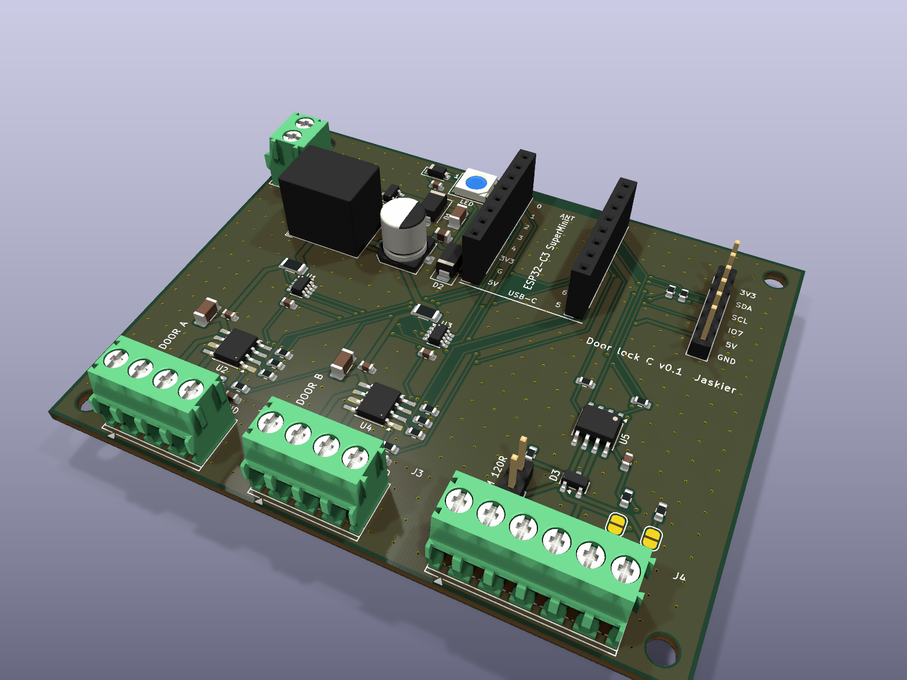
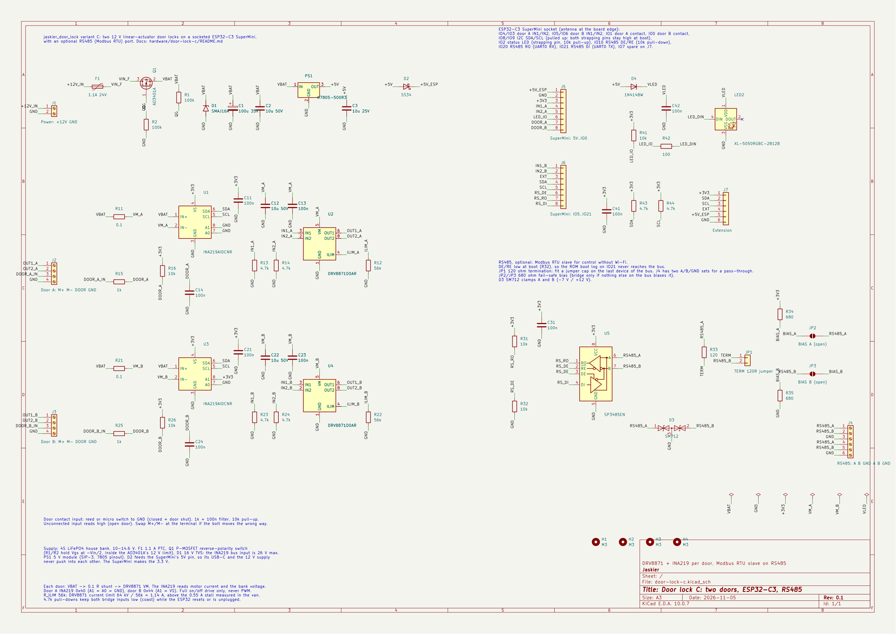

# Door lock C: two doors, ESP32-C3 SuperMini, optional RS485

A board for two 12 V linear-actuator door locks. Each door gets what variant A uses as
breakout boards (a DRV8871 H-bridge and an INA219 on a 0.1 Ω high-side shunt), plus an input
for a wired magnetic door contact. One socketed ESP32-C3 SuperMini runs both doors. An optional
RS485 port lets Home Assistant lock and unlock over Modbus RTU through the van's RS485 gateways
when Wi-Fi is down. It is a bare JLCPCB board with parts from LCSC, assembled by hand, and is
ordered together with the CAN-B node (jaskier repo, `hardware/canb-node`).

**Status: designed 5 November 2026, not ordered, not built, not tested.** Firmware:
[`door_lock_c.yaml`](../../door_lock_c.yaml), see [Firmware](#firmware). KiCad 10 project: ERC 0 violations, DRC 0
violations, 0 unconnected, schematic and board in parity.



## What it does

- **Two independent doors.** Each door has the same current path as variant A: bank → 0.1 Ω shunt
  → DRV8871 VM → actuator. The INA219 on that shunt reads the motor current at 20 Hz and the
  bank voltage. Door A's INA219 is at I²C address 0x40, door B's at 0x44.
- **A door contact input per door.** A wired magnetic contact (reed, NO or NC) goes between DOOR
  and GND on the door's terminal. It has a 10 kΩ pull-up and a 1 kΩ + 100 nF filter for the long
  cable. The firmware chooses the polarity. With nothing connected the input reads open.
- **Optional RS485.** An SP3485 (3.3 V) on UART0, with the driver enable held low while the
  ESP32 boots, and an SM712 clamp on A/B. J4 has two A/B/GND sets for a bus that passes through.
  The 120 Ω termination sits on a 2-pin header: fit the jumper cap on the last device of the bus.
  A 680 Ω fail-safe bias is on solder jumpers (open). Leave J4 empty and the board works on
  Wi-Fi alone.
- **Socketed SuperMini.** Two 1×8 female headers. The antenna sits at the board edge over a copper
  keep-out. The USB-C end faces the board with only low SMD parts in front of it, so a cable can
  reach it with the module in its socket.
- **Status LED.** One WS2812B-type RGB LED (XL-5050RGBC-2812B, 5050, side pads) on IO2. It is
  powered from 5 V through a diode (about 4.3 V), so the 3.3 V data line meets its input threshold.
- **Supply:** from the 4S LiFePO₄ house bank, through a 1.1 A PTC, a P-MOSFET reverse-polarity
  switch, a 16 V TVS and 100 µF + 10 µF. A 5 V module (K7805-500R3, the CAN-B part) feeds the
  SuperMini through a Schottky, so USB and the 12 V supply never push into each other.
- **Extension header J7:** 3.3 V, I²C (SDA/SCL), IO7, 5 V and GND, for a sensor or a button.

## What the van's readings changed

Home Assistant's recorder covered 26 October to 5 November 2026 for the back door lock (variant A,
`lock.jaskier_back_door_lock_door_lock`):

| Measurement | Value |
|---|---|
| Stroke, locking | 1.83–1.95 s |
| Stroke, unlocking | 2.01–2.07 s |
| Running current (1 Hz samples during moves) | 0.052–0.066 A |
| Peak per move (20 Hz, inrush included) | 0.07–0.18 A |
| Stall (two jams on 3 November) | 0.548 A and 0.559 A at 13.0 V |
| Standing current | 0.1–3 mA |
| Bank voltage | 12.61–14.31 V |
| Moves | 7: 2 locks and 3 unlocks that ended normally (current collapse at the actuator's end switch), plus 2 jams. One more lock (1.87 s) is from before the window |
| Jams | 3 November 13:47: two unlocks stalled at 0.53 s and 0.55 s, then the third, 6 s later, unlocked normally in 2.01 s |
| Connectivity | 17 "unavailable" gaps of 2–6 s, each at the same second as one of the front controller's: Home Assistant restarts, not Wi-Fi drops. No reboots (the last-move values survived every gap) |

What this changed on the board:

| Change | Why |
|---|---|
| DRV8871 current limit 1.14 A (R_ILIM 56 kΩ) | The Adafruit breakout's 30 kΩ sets about 2.1 A, four times the 0.55 A stall. 1.14 A is still twice the stall, so a normal move or a stall never reaches it. It limits a shorted actuator cable in the driver itself, whatever the firmware does |
| P-MOSFET instead of a series diode for reverse polarity | The INA219 measures the bank behind the protection. A Schottky would make the reading 0.2–0.45 V low, depending on the load. The FET drops about 0.05 V at full load and nothing at rest |
| 16 V TVS | The bank peaked at 14.3 V. The INA219's bus input is rated 26 V absolute maximum, and SMAJ16A clamps below that |
| 1.1 A PTC | Both actuators stalling at once draw about 1.1–1.2 A for the 0.55 s the firmware needs to stop them, which is far too short to trip it. Normal moves draw 0.15 A for both doors |
| Door contact inputs | Asked for. They also explain jams like 3 November's: a bolt bound by a door pulled against its seal. The firmware can report the door open or shut, refuse to lock an open door and lock when it closes, also over RS485 |
| RS485 | Asked for: control that does not depend on Wi-Fi |

The firmware thresholds of variant A still fit these readings. Idle 0.01 A is well below the
0.05 A running current, stall 0.40 A sits between 0.18 A and 0.55 A, min travel 1.5 s is
75–82 % of the strokes, and max travel 4.5 s is more than twice the longest. The hard limit of
0.60 A is only 8 % above the 13.0 V stall: a stall at 14.4 V may end as "hard limit" rather than
"stall". Both are jams, so it changes only the message. One firmware change worth making: after
an early stall on an unlock, retry once before latching the jam, since the third manual attempt
on 3 November worked.

## Connections



All wires enter from the board edge: power on the left, doors and RS485 at the bottom. The
terminals are 3.5 mm pitch screw terminals.

### J1, power

| Pin | Label | Connect to |
|---|---|---|
| 1 | +12V | House bank +, through a 2–3 A fuse at the bank |
| 2 | GND | House bank − |

### J2 (door A) and J3 (door B)

| Pin | Label | Connect to |
|---|---|---|
| 1 | M+ | Actuator lead A (swap with M− if the bolt moves the wrong way) |
| 2 | M− | Actuator lead B |
| 3 | DOOR | Door contact, one wire |
| 4 | GND | Door contact, other wire |

Twist the actuator pair. A powered (three-wire) door sensor needs its supply from J7.

### J4, RS485

| Pin | Label | Signal |
|---|---|---|
| 1, 4 | A | RS485 A (non-inverting) |
| 2, 5 | B | RS485 B (inverting) |
| 3, 6 | GND | Signal ground |

The two sets are joined on the board: the bus comes in on one and goes on from the other. On the
last device, use one set and terminate.

- **TERM 120R (JP1):** a 2-pin header with a 120 Ω resistor behind it across A–B. Fit the jumper
  cap when this board ends the bus, leave it off when the bus continues from J4.
- **BIAS (JP2 and JP3):** solder jumpers, 680 Ω from A to 3.3 V and from B to GND. Bridge both only
  if nothing else on the bus biases it.

### J7, extension (2.54 mm)

| Pin | Label | Signal |
|---|---|---|
| 1 | 3V3 | SuperMini 3.3 V |
| 2 | SDA | I²C (IO8), 4.7 kΩ pull-up on the board |
| 3 | SCL | I²C (IO9), 4.7 kΩ pull-up on the board |
| 4 | IO7 | Spare GPIO, no pull-up |
| 5 | 5V | 5 V behind the Schottky (about 4.6 V) |
| 6 | GND | |

Avoid I²C addresses 0x40 and 0x44 on J7: the INA219s use them.

### SuperMini socket (J5, J6)

Plug the module in component side up, antenna at the board edge ("ANT") and USB-C toward the
board ("USB-C"). The silkscreen between the socket rows repeats the module's pin labels: check they
match before plugging it in. The pin order was checked against the vendor data sheet's top-view
drawing and two independent KiCad footprints.

| Pin | Function | Notes |
|---|---|---|
| IO4 | Door A IN1 (drives towards unlocked) | 4.7 kΩ pull-down |
| IO3 | Door A IN2 (drives towards locked) | 4.7 kΩ pull-down |
| IO5 | Door B IN1 | 4.7 kΩ pull-down |
| IO6 | Door B IN2 | 4.7 kΩ pull-down |
| IO1 | Door A contact | Low = contact closed |
| IO0 | Door B contact | Low = contact closed |
| IO8 | I²C SDA | Strapping pin, held high by the pull-up. The SuperMini's blue LED is on this pin and flickers with I²C traffic |
| IO9 | I²C SCL | Strapping pin (BOOT), held high by the pull-up |
| IO2 | Status LED (WS2812B-type, 5050) | Strapping pin, 10 kΩ pull-up |
| IO10 | RS485 DE/RE | 10 kΩ pull-down: receive while the ESP32 boots |
| IO20 | RS485 RO (UART0 RX) | 10 kΩ pull-up |
| IO21 | RS485 DI (UART0 TX) | The ROM boot log on this pin never reaches the bus (DE is low) |
| IO7 | Spare, on J7 | |
| 5V | From the board's 5 V through D2 | |
| 3V3 | SuperMini regulator: INA219s, SP3485, pull-ups, J7 | |

Pins that hold their own pull-up at boot (IO2, IO8, IO9) carry nothing that a closed door contact
could pull low. A door shut at power-up cannot put the ESP32 in download mode.

## RS485 and Modbus

The board is a Modbus RTU slave (server). It is meant for one of the van's RS485 buses, or a new
one, through a Waveshare RS485-to-Ethernet gateway, and Home Assistant's Modbus integration
(`modbus/README.md` and `docs/modbus-addressing.md` in the HA config repo). It runs 9600 8N1 like
the other buses, at slave address 60 (free on every van bus on 5 November 2026). Both are
substitutions at the top of `door_lock_c.yaml`.

Register map (0-based; holding registers FC 3/4 to read, FC 6/16 to write; coils FC 1/5/15):

| Address | Kind | Content |
|---|---|---|
| coil 0 / 1 | read/write | Door A / B: 1 = locked. Write 1 to lock, 0 to unlock |
| 0 / 1 | write | Door A / B command: 1 lock, 2 unlock, 3 stop, 4 clear fault (reads 0) |
| 2 / 3 | read | Door A / B lock state: 0 unknown, 1 locked, 2 unlocked, 3 jammed, 4 locking, 5 unlocking |
| 4 / 5 | read | Door A / B contact: 0 shut, 1 open, 2 contact not in use |
| 6 / 7 | read | Door A / B fault latched: 0 / 1 |
| 8 | read | Bank voltage, mV (door A's INA219) |
| 9 / 10 | read | Door A / B last move peak current, mA |
| 11 / 12 | read | Door A / B last move duration, ms |
| 13 | read | Firmware version (100 = 1.0.0) |

A lock command (coil write 1, or command 1) while that door's contact reads open is refused
with exception 4 (device failure), and the bolt does not move. An unknown command value is
refused with exception 4 too.

Home Assistant has no Modbus lock platform. A `switch` on the coil works, for example on the
`rs485_1` hub:

```yaml
switches:
  - name: Door A lock (RS485)
    slave: 60
    address: 0
    write_type: coil
    verify:
      input_type: coil
      address: 0
sensors:
  - name: Door A lock state (RS485)
    slave: 60
    address: 2
    input_type: holding
    scan_interval: 5
```

A template lock can call `modbus.write_register` with command 1 or 2 instead.

## Firmware

[`door_lock_c.yaml`](../../door_lock_c.yaml) (repo root). It reuses the per-door packages:

| Package | Per door | What |
|---|---|---|
| `packages/door.yaml` | yes | Variant A's state machine: INA219 at 20 Hz, stall/idle/timeout, back-off, thresholds as HA numbers |
| `packages/door_contact.yaml` | yes | The door contact: "Door A door" (device class door), "use door contact" (off by default), "contact closed when shut" (on by default) |

Variant B's position switches and buttons moved out of `door.yaml` into
`packages/door_switches.yaml`, which only variant B includes. `door.yaml` now only reads three
globals that those packages write (`_at_locked`, `_at_unlocked`, `_lock_inhibit`).

- **Base:** board `esp32-c3-devkitm-1`, framework `esp-idf`, ESPHome 2026.8 or newer. The logger
  runs on `USB_SERIAL_JTAG`, so UART0 (IO20/IO21) is free for RS485.
- **Doors:** "Door A" (IO4 unlock, IO3 lock, INA219 0x40, contact IO1) and "Door B" (IO5, IO6,
  0x44, contact IO0). Every per-door entity of variant A exists once per door.
- **Door contact:** while "use door contact" is on, a lock command for an open door is refused,
  from HA and from Modbus alike, and the last result reads "refused - door open". The jog buttons
  (commissioning only, disabled by default) bypass it, as they bypass all protection.
- **No reboot without Wi-Fi or Home Assistant:** `reboot_timeout: 0s` on both `wifi` and `api`.
  The defaults reboot after 15 minutes, which would also interrupt RS485 control.
- **Status LED (IO2):**
  - red: a fault is latched
  - white: a door is moving
  - amber: no Wi-Fi
  - dim green: all quiet
  - green flash: a move finished
- **Extra entities:** supply voltage (door A's INA219), Wi-Fi signal, uptime.
- **Checked:** `esphome config` passes for variants A, B and C on ESPHome 2026.10.2, and variant C
  compiles. Not yet run on hardware.

## Design notes

- **H-bridge:** DRV8871DDAR, full on/off, never PWM (variant A's rule). Both inputs low means coast
  and sleep. The 4.7 kΩ pull-downs hold the inputs below the 0.5 V low threshold even against the
  ESP32-C3's internal pull-ups (about 45 kΩ) while it resets.
- **Current sense:** 0.1 Ω 1 % 1206 shunt per door. The INA219's IN+ and IN− run as separate
  traces from the shunt pads (Kelvin), so motor current in the supply traces does not reach the
  reading.
- **Reverse polarity:** AO3401A with its drain to the input. R1/R2 (100 kΩ each) hold Vgs at
  −Vin/2: −5 V at 10 V, −7.3 V at 14.6 V, inside the ±12 V limit. Reversed, the gate sees 0 V and
  the FET stays off.
- **Status LED supply:** 5 V − 0.7 V (1N4148W) ≈ 4.3 V. The XL-5050RGBC-2812B data sheet gives
  VDD 3.5–5.5 V and an input-high threshold of 0.7 × VDD, so about 3.0 V, and the SuperMini drives
  3.3 V. Its pins are the WS2812B's: 1 VDD, 2 DO, 3 GND, 4 DI.
- **Layout:** 80 × 64 mm, 2 layers, 1.6 mm, ground pour on both sides, stitching vias, four M3
  holes. Tracks: 1.0 mm for the input, 0.8 mm for the bank rail, 0.6 mm for motor and VM, 0.2 mm
  for signals. Clearance 0.15 mm (JLCPCB's two-layer minimum is 0.127 mm). The DRV8871 thermal
  pads have vias to the bottom pour.
- **Not on the board:** a fuse holder (fuse the supply at the bank) and position switches (the
  actuator's own end switches end every normal move, as the readings show).

## Ordering

Bare boards from JLCPCB, parts from LCSC, assembled by hand. One order covers this board, the
CAN-B node and the RS485 tee (jaskier repo, `hardware/rs485-tee`).

- **PCB:** `jlcpcb/door-lock-c-gerbers.zip`, 2 layers, 1.6 mm, 1 oz, lead-free HASL. ENIG would keep the 0.65 mm
  INA219 pads flatter, but costs €15 more. No assembly, so no edge rails and no placement file are
  needed.
- **Stencil (optional):** a top-side SMT stencil from the same zip (the F.Paste layer), worth it
  with a hot plate or hot air. Add it to the same JLCPCB cart.
- **Parts:** `jlcpcb/lcsc-order.csv` is one LCSC order for 3 door-lock-c boards, 2 CAN-B nodes and
  10 RS485 tees, with spares (+20 % or at least 2 for chip passives, +1 for the rest), including the
  TERM jumper caps. For other counts: `python tools/lcsc_order.py --door N --canb M --tee K`.
  - **Substitutions:** when LCSC runs out of a BOM part, `SUBSTITUTE` in the script buys an
    equivalent. On 5 November 2026 these were C1591 for the 100 nF (C14663, 50 left) and C1589 for
    CAN-B's 10 nF (C57112, none), both Samsung, X7R, 50 V, 0603.
  - **Loading it:** LCSC's BOM tool, "Copy & Paste", one `C-number, quantity` per line. It keeps the
    part numbers but sets every requested quantity to 1. Set the lines whose need is above LCSC's
    minimum order by hand (filter the table by part number, then re-tick Select All). LCSC rounds
    each line up to its minimum.
- **Stock on LCSC, 5 November 2026:**

  | Part | LCSC | Stock |
  |---|---|---|
  | DRV8871DDAR | C75864 | 3,497 |
  | INA219AIDCNR | C87469 | 2,324 |
  | SP3485EN | C8963 | 162,946 |
  | XL-5050RGBC-2812B | C2843785 | 1,311,820 |
  | SM712 | C172881 | 21,980 |
  | SMAJ16A | C364288 | 17,740 |
  | PTC BSMD1812-110-24V | C883149 | 20,950 |
  | K7805-500R3 | C2992390 | 5,594 |
  | Terminal 2P / 4P / 6P | C466970 / C2757925 / C5290323 | 34,985 / 35,415 / 11,757 |
  | Header 1×2 / jumper cap | C492401 / C100114 | 795,650 / 343,900 |
  | CAN-B: TJA1055T/3 | C2671216 | **9** |

  The CAN-B node's TJA1055T/3 is the scarce part: 9 at LCSC, as at JLCPCB. Do not substitute the
  plain TJA1055T (CAN-B README).
- **CAN-B:** its README records an order with JLCPCB assembly on 5 November 2026 (batch
  W2026110523426514). If that order changes to bare boards, update its README the same way.
- **Prepared 5 November 2026, not yet paid:**
  - **LCSC cart** "Jaskier door lock C + CAN-B + RS485 tee": 41 lines, $80.08 less a $5.57
    discount, plus $16.81 shipping to Poland. Total $91.32.
  - **JLCPCB cart**, all lead-free HASL, green, 1.6 mm:

    | Item | Price |
    |---|---|
    | door-lock-c, 5 PCBs | €4.62 |
    | door-lock-c stencil, top, 380 × 280 mm, no frame | €6.41 |
    | CAN-B node, 5 PCBs | €4.62 |
    | RS485 tee, 10 PCBs | €5.59 |
    | Shipping, estimate (DHL) | €27.13 |
    | **Total** | **€48.37** |

  - **Left out to save money:** ENIG (+€15.27 per design) and a CAN-B stencil. The stencil adds
    €6.41 and about 0.8 kg, which doubled the shipping estimate.
- `python.exe tools/jlcpcb.py --cpl` still writes a JLCPCB placement file, in case a later batch is
  assembled by JLCPCB. Its rotations follow the CAN-B rule and were never checked in JLCPCB's
  preview.

## Assembly

Use `docs/assembly-top.pdf` (part outlines, references, pad numbers; zoom in) with
`jlcpcb/bom.csv` (values per reference) and `docs/board-top.png`. All parts sit on the top side.

1. **SMD, smallest first.** The 0603 passives, then:
   - Q1 and D3 (SOT-23).
   - U1 and U3 (SOT-23-8, 0.65 mm pitch): flux and drag-solder, then check for bridges under a
     loupe.
   - U5 (SOIC-8).
   - U2 and U4 (DRV8871).
   - The SMA diodes, F1, the 1206 parts, LED2 and C1.
2. **DRV8871 thermal pad.** With a stencil, paste it and reflow on a hot plate or with hot air.
   With an iron only, solder the pins first, then feed solder into the pad's six vias from the
   bottom side, with flux. The pad is ground, and pins 1 and 7 are ground as well. At this duty
   (2 s moves, under 0.6 A) the pad's heat path is not critical, but solder it anyway.
3. **Polarity.**
   - D1 (SMAJ16A), D2 (SS34) and D4 (1N4148W): the cathode band goes on the bar of the
     footprint.
   - C1: + on the marked pad.
   - LED2: the cut corner is pin 3 (GND), bottom right.
   - Q1, D3 and U1–U5: pin 1 at the dot.
4. **Through-hole.**
   - J5/J6: solder them with the SuperMini plugged in, so they stay parallel.
   - J7 and JP1.
   - PS1: the square pad is IN.
   - J1–J4: wire entry toward the board edge.
5. **Before power,** with a meter:
   - J1: +12V to GND must not be a short. C1 charging shows as a rising resistance.
   - J7: 5V (pin 5) and 3V3 (pin 1) to GND, also not a short.

## Bring-up

1. SuperMini out, J4 empty, no cap on TERM, BIAS open. Put 12 V on J1: J7 pin 5 reads about
   4.6 V. With the module out, nothing on the board shows power.
2. Flash the SuperMini over USB with the 12 V off the first time. Later updates go over Wi-Fi.
3. With the module in, the boot log must find I²C devices at 0x40 and 0x44. Supply voltage must
   read the bank (within about 0.05 V of a meter at J1).
4. Actuators off: each door's motor current should read a few mA at most.
5. Connect each actuator and run variant A's commissioning per door (jog to check direction, then
   a full stroke for the travel times).
6. Door contacts: turn on "use door contact", then open and close each door and watch its door
   sensor. Flip "contact closed when shut" if it reads the wrong way round.
7. RS485: connect to a gateway, set the bus address, fit the TERM cap if the board ends the bus, and
   read register 2 from Home Assistant or `tools/modbus_addressing.py read` on the addressing hub.

## Files

| Path | What |
|---|---|
| `door-lock-c.kicad_pro`, `.kicad_sch`, `.kicad_pcb` | KiCad 10 project (standard KiCad libraries only) |
| `jlcpcb/` | Gerbers and drills (zip), BOM, combined LCSC order with the CAN-B node |
| `docs/` | Schematic PDF and PNG, assembly drawing, board renders |
| `tools/parts.py` | Parts, nets, LCSC numbers: the schematic's source |
| `tools/layout.py` | Placement, routing jobs, silkscreen |
| `tools/gen_sch.py` | Writes the schematic and project (any Python 3) |
| `tools/gen_pcb.py`, `tools/router.py` | Build and route the board (KiCad's `python.exe`): placement from `layout.py`, then a two-layer A* grid router (0.1 mm grid, clearance-aware, bends and vias cost extra), GND vias, stitching, pours |
| `tools/jlcpcb.py` | Gerbers, drills, BOM, assembly drawing; `--cpl` for a JLCPCB placement file (KiCad's `python.exe`) |
| `tools/lcsc_order.py` | One LCSC order for door-lock-c boards, CAN-B nodes and RS485 tees (any Python 3) |

Regenerate everything from the project directory:

```bash
python tools/gen_sch.py .
```

```bash
kicad-cli sch export netlist -o netlist.net door-lock-c.kicad_sch
```

```bash
"$LOCALAPPDATA/Programs/KiCad/10.0/bin/python.exe" tools/gen_pcb.py netlist.net door-lock-c.kicad_pcb
```

```bash
"$LOCALAPPDATA/Programs/KiCad/10.0/bin/python.exe" tools/jlcpcb.py
```

```bash
python tools/lcsc_order.py --door 3 --canb 2 --tee 10
```

Regenerating overwrites hand edits made in KiCad. Routing takes about two minutes.

## Sources

- TI DRV8871 data sheet (SLVSCY9B): <https://www.ti.com/lit/ds/symlink/drv8871.pdf>
  (I_TRIP = 64 kV / R_ILIM, R_ILIM ≥ 15 kΩ)
- TI INA219 data sheet (SBOS448G): <https://www.ti.com/lit/ds/symlink/ina219.pdf> (DCN pinout,
  address table)
- ESP32-C3 SuperMini vendor data sheet (top-view drawing with pin labels):
  <https://cdn.espboards.net/boards/esp32-c3-super-mini/docs/datasheet.pdf>
- ESPHome Modbus server: <https://esphome.io/components/modbus/>
- Variant A firmware and wiring: [`../../door_lock_a.yaml`](../../door_lock_a.yaml),
  [`../../README.md`](../../README.md)
