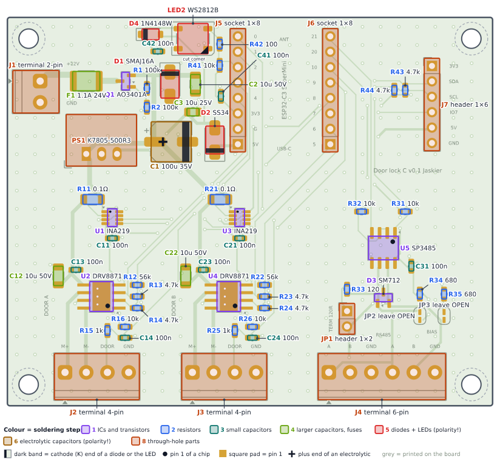
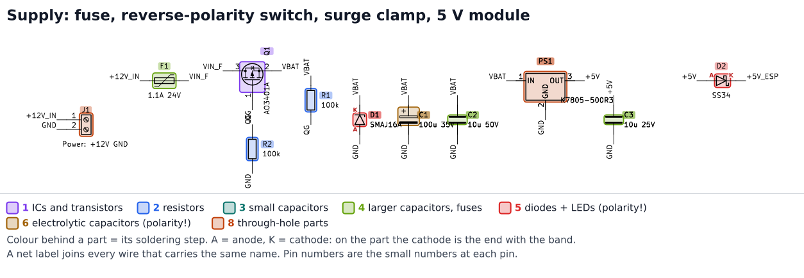
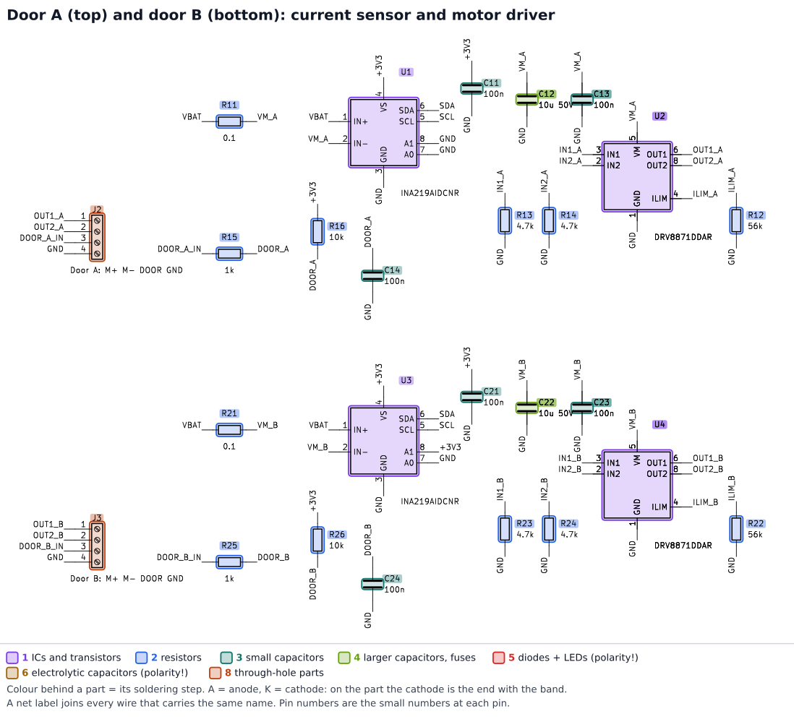
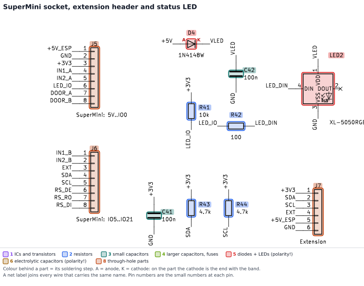
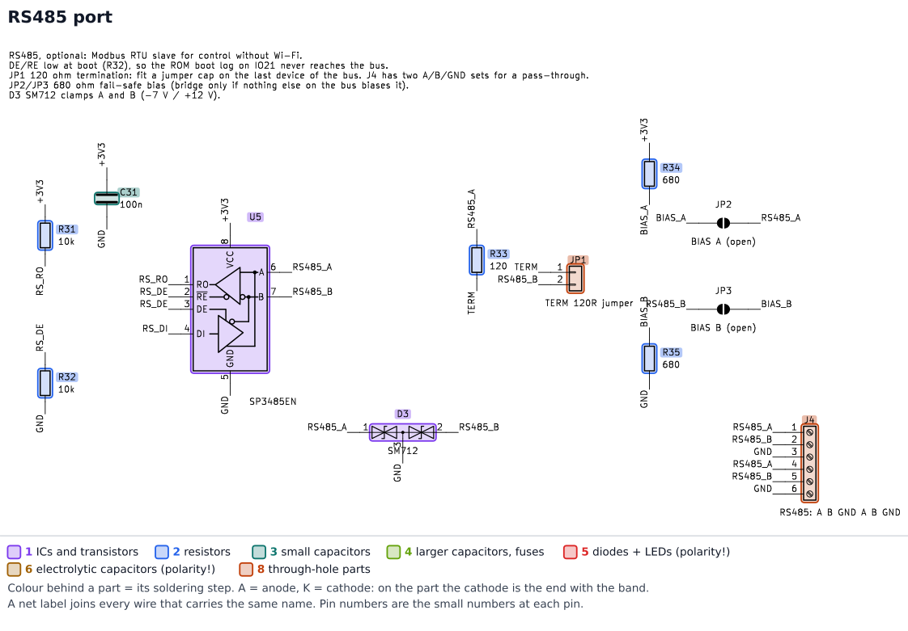

# Door lock C v0.1: soldering guide

Hand assembly of one door lock C board (JLCPCB order W2026110603218840) with the parts from LCSC
order WM2611060105. Every part sits on the top side. It has 58 parts, five chips among them: the
first board takes three to four hours. Print [`soldering-guide.pdf`](soldering-guide.pdf) and
tick the boxes as you go.

> **Three things that matter most**
>
> 1. **Polarity and pin 1:** U1–U5, D1, D2, D4, LED2, C1 and PS1 go in one way only. Most of the
>    chips have no clear pin-1 dot: section 5 says how to find pin 1 on each one. U2 or U4 turned
>    round puts the battery straight onto its ground pin.
> 2. **JP2 and JP3 stay open.** They are the two small solder jumpers marked BIAS. No solder on
>    them. The jumper cap for JP1 (TERM) goes on only if the board ends an RS485 bus.
> 3. **LED2 is fragile.** At most 300 °C and 3 s per pin, soldered once. Keep it in its sealed bag
>    until step 5 (it takes up moisture: see step 5).

## 1. What you need

- **Soldering iron** with temperature control and a **chisel or bevel tip** of 1.5–2.4 mm, and
  if you have one a **fine conical tip** for the SOT-23-8 chips.
- **Solder wire** with a flux core: 0.5 mm for the small parts, 0.8 mm for the through-hole
  parts. Leaded (Sn60/Pb40 or Sn63/Pb37) is the easiest; lead-free also works.
- **Flux** (no-clean gel or pen). The most useful thing on this list: the INA219s have pins
  0.65 mm apart.
- **Solder wick** (desoldering braid), 1.5–2 mm.
- **Tweezers**, fine and curved, not magnetic.
- **Magnification:** a loupe, or your phone's camera zoomed in. Plus a bright lamp.
- **Multimeter** with continuity (beep), resistance, diode test and DC volts.
- **Isopropyl alcohol** (IPA) and an old toothbrush, to wash off flux.
- **Something to hold the board:** a PCB holder, helping hands, or tape onto the desk mat.
- **For the first power-up:** a 12 V bench supply with a current limit, or the house battery
  through a 1 A fuse.
- An earthed wrist strap or at least a habit of touching something earthed: LED2 and the chips
  are sensitive to static.
- Fume extraction or an open window, and glasses.

## 2. Parts for one board

The bags are shared with the CAN-B node and the RS485 tee. Find a bag by the **LCSC number**
(C…) on its label; the label's *Mfr. Part #* line is the **order name** below. Take out only what
one board needs.

| Step | Ref | Qty | Value | Order name (Mfr. Part #) | LCSC | Package | Way round |
|---|---|---|---|---|---|---|---|
| 1 | U2, U4 | 2 | motor driver | DRV8871DDAR (TI) | C75864 | HTSOP-8 with a pad underneath | pin 1 at the ▲, bottom right |
| 1 | U5 | 1 | RS485 transceiver | SP3485EN-L/TR (MaxLinear) | C8963 | SOIC-8 | pin 1 at the ◀, top right |
| 1 | U1, U3 | 2 | current sensor | INA219AIDCNR (TI) | C87469 | SOT-23-8 | dot at the ▼, top left |
| 1 | Q1 | 1 | P-channel MOSFET | AO3401A (AOS) | C15127 | SOT-23 | fits one way: the single pin to the left |
| 1 | D3 | 1 | RS485 surge clamp | SM712-02HTG (Littelfuse) | C172881 | SOT-23 | fits one way: the single pin up |
| 2 | R11, R21 | 2 | 0.1 Ω 1 % | 1206W4F100LT5E (UNI-ROYAL) | C25334 | 1206 | any |
| 2 | R42 | 1 | 100 Ω | 0603WAF1000T5E (UNI-ROYAL) | C22775 | 0603 | any |
| 2 | R33 | 1 | 120 Ω | 0603WAF1200T5E (UNI-ROYAL) | C22787 | 0603 | any |
| 2 | R34, R35 | 2 | 680 Ω | 0603WAF6800T5E (UNI-ROYAL) | C23228 | 0603 | any |
| 2 | R15, R25 | 2 | 1 kΩ | 0603WAF1001T5E (UNI-ROYAL) | C21190 | 0603 | any |
| 2 | R13, R14, R23, R24, R43, R44 | 6 | 4.7 kΩ | 0603WAF4701T5E (UNI-ROYAL) | C23162 | 0603 | any |
| 2 | R16, R26, R31, R32, R41 | 5 | 10 kΩ | 0603WAF1002T5E (UNI-ROYAL) | C25804 | 0603 | any |
| 2 | R12, R22 | 2 | 56 kΩ | 0603WAF5602T5E (UNI-ROYAL) | C23206 | 0603 | any |
| 2 | R1, R2 | 2 | 100 kΩ | 0603WAF1003T5E (UNI-ROYAL) | C25803 | 0603 | any |
| 3 | C11, C13, C14, C21, C23, C24, C31, C41, C42 | 9 | 100 nF 50 V | CL10B104KB8NNNC (Samsung) | C1591 | 0603 | any |
| 4 | C3 | 1 | 10 µF 25 V | CL21A106KAYNNNE (Samsung) | C15850 | 0805 | any |
| 4 | C2, C12, C22 | 3 | 10 µF 50 V | CL31A106KBHNNNE (Samsung) | C13585 | 1206 | any |
| 4 | F1 | 1 | resettable fuse 1.1 A 24 V | BSMD1812-110-24V (BHFUSE) | C883149 | 1812 | any |
| 5 | D1 | 1 | TVS diode 16 V | SMAJ16A (MDD) | C364288 | SMA | band up |
| 5 | D2 | 1 | Schottky diode 40 V 3 A | SS34 (MDD) | C8678 | SMA | band down |
| 5 | D4 | 1 | diode | 1N4148W (ST(Semtech)) | C81598 | SOD-123 | band to the left |
| 5 | LED2 | 1 | RGB LED, WS2812B type | XL-5050RGBC-2812B (XINGLIGHT) | C2843785 | 5 × 5 mm | cut corner bottom right |
| 6 | C1 | 1 | 100 µF 35 V electrolytic | RVT1V101M0607 (ROQANG) | C72478 | 6.3 × 7.7 mm | + to the left, black half to the right |
| 8 | J7 | 1 | pin header 1×6 | PZ254V-11-06P (XFCN) | C492405 | 2.54 mm | short pins into the board |
| 8 | JP1 | 1 | pin header 1×2 | PZ254V-11-02P (XFCN) | C492401 | 2.54 mm | short pins into the board |
| 8 | J5, J6 | 2 | female socket 1×8 | 2.54-1\*8P (BOOMELE) | C27438 | 2.54 mm | either way, keep them parallel |
| 8 | PS1 | 1 | 5 V module | K7805-500R3 (YLPTEC) | C2992390 | SIP-3 | printed side down, dot over the square pad |
| 8 | J1 | 1 | screw terminal 2-pin | DB125-3.5-2P-GN-S (DORABO) | C466970 | 3.5 mm | wire openings to the left edge |
| 8 | J2, J3 | 2 | screw terminal 4-pin | DB125-3.5-4P-GN-S (DORABO) | C2757925 | 3.5 mm | wire openings to the bottom edge |
| 8 | J4 | 1 | screw terminal 6-pin | DB125-3.5-6P-GN-S (DORABO) | C5290323 | 3.5 mm | wire openings to the bottom edge |

- **One number differs from `jlcpcb/bom.csv`:** the order bought C1591 for the 100 nF capacitors
  (bom.csv: C14663), the same value from Samsung, because LCSC had run out.
- **The bag label for LED2** may read XL-5050RGBC-WS2812B: the same part.
- **Not soldered:** JP2 and JP3 (BIAS, stay open), H1–H4 (M3 holes), the jumper cap for JP1
  (BOOMELE "2.54", C100114; on only if the board ends the bus). The ESP32-C3 SuperMini is not from
  this order; it plugs into J5 and J6 at the end.

## 3. Where each part goes

## 4. Schematic, 1 of 4: supply

## 4. Schematic, 2 of 4: the two doors

## 4. Schematic, 3 of 4: SuperMini socket and LED

## 4. Schematic, 4 of 4: RS485

## 5. Soldering order

Small and flat parts first, tall parts last, so the iron always reaches the pads. The colours
are the ones in the drawings.

### Which way round

Hold the board as in the drawing: the 2-pin terminal J1 at the top left, the three big terminals
along the bottom edge, the text "Door lock C v0.1 Jaskier" readable. Then:

- **The chips.** A chip's pin 1 is marked on the chip by a dot, a dimple or a bevelled long edge,
  but often by nothing you can see. Then: **hold the chip so its text reads the right way up; pin
  1 is the bottom left pin.** On the board, pin 1 of each chip is next to a small printed
  triangle:
  - **U2, U4** (DRV8871, "8871"): pin 1 at the **bottom right**, by the ▲. Pins 1–4 run up the
    right side. Turn the board a quarter turn clockwise and the chip goes down with its text the
    right way up.
  - **U5** (SP3485, "SP3485E"): pin 1 at the **top right**, by the ◀. Turn the board half a turn
    and the chip goes down with its text the right way up.
  - **U1, U3** (INA219, "A219", with a dot): pin 1 at the **top left**, by the ▼. Turn the board
    a quarter turn anticlockwise and the chip goes down with its text the right way up, the dot
    bottom left.
- **Q1 and D3** (3-pin SOT-23): they fit one way only. Q1's single pin points **left**, D3's
  single pin points **up**.
- **D1** (between R1 and C2): band **up**. **D2** (right of C1): band **down**. **D4** (top, left
  of LED2): band to the **left**. On the board each diode's printed outline is closed on one end,
  like `]`: the band goes to the closed end.
- **LED2** (top middle): its **cut corner** goes to the **bottom right**, where the printed
  outline has its own cut corner. That corner is pin 3, GND.
- **C1** (the can, right of PS1): the **+** and the outline's two cut corners are on the
  **left**. On the can, the black half of the top is minus: it goes to the **right**. The can's
  plastic base has its cut corners on the + side.
- **PS1:** the printed side (text "K7805-500R3" and a dot) faces **down**, toward R11. The dot
  sits over the square pad, the module's IN pin, where the outline has an L-mark.
- **J1:** wire openings to the **left edge**. **J2, J3, J4:** wire openings to the **bottom
  edge**. The screws face up.
- **J5, J6, J7, JP1:** the square pad is pin 1.

### Step 0: prepare

- [ ] **Practise first** on a spare board with spare 0603 resistors (the 0603 method is in
  section 8). The INA219s are the hardest parts here: try a drag-solder on a spare too if you can.
- [ ] Clean the board's pads with IPA if they were handled.
- [ ] Set the iron: about **330 °C** for leaded solder, **360 °C** for lead-free. Wet the sponge
  or use brass wool, and tin the tip.
- [ ] Touch something earthed before handling the chips or the LED.

### Step 1: the chips and transistors (purple)

The chips first, while nothing stands around them. For each chip: **find pin 1 on the chip, flux
the pads, tin one corner pad, place the chip, reheat that pad, check, solder the opposite
corner, check again, then the rest.**

- [ ] **U2 and U4** (DRV8871, in the lower half, one per door). Pin 1 at the ▲, bottom right.
  Solder the eight pins. Then the pad underneath: turn the board over, flux the six small holes
  under the chip, and feed solder into each with the iron on the hole's ring for 3–5 s, until it
  flows in and stays (the pad is ground on a big copper area: it needs heat). The pad matters
  little at this motor's 2-second moves, but solder it anyway.
- [ ] **U5** (SP3485, right of the middle). Pin 1 at the ◀, top right: the text is upside down
  when the board is held as in the drawing.
- [ ] **U1 and U3** (INA219, above U2 and U4). Pin 1 at the ▼, top left; the chip's dot goes
  there. These pins are 0.65 mm apart: flux all eight pads, tack two opposite corners, then
  drag a lightly tinned tip along each row; wick the bridges (section 8).
- [ ] **Q1** (top left, next to F1): the single pin to the left.
- [ ] **D3** (right, between JP1 and JP2): the single pin up.
- [ ] Check every chip pin under magnification and light from the side: each one wetted, no
  bridges.

### Step 2: resistors (blue)

One value at a time, bag closed again before the next. 0603 resistors may carry a printed code
or none at all: if you are not sure, measure a loose one.

- [ ] **0.1 Ω (1206):** R11 and R21, the two bigger resistors above U1 and U3.
- [ ] **100 Ω:** R42 (top, right of LED2).
- [ ] **120 Ω:** R33 (above JP1).
- [ ] **680 Ω:** R34 and R35 (right, above JP2 and JP3).
- [ ] **1 kΩ:** R15 and R25 (below U2 and U4).
- [ ] **4.7 kΩ:** R13, R14 (right of U2), R23, R24 (right of U4), R43, R44 (top right, left of
  J7).
- [ ] **10 kΩ:** R16 (below U2), R26 (below U4), R31, R32 (above U5), R41 (top, below R42).
- [ ] **56 kΩ:** R12 (right of U2, top) and R22 (right of U4, top).
- [ ] **100 kΩ:** R1 and R2 (top left, right of Q1).
- [ ] Do not put anything on **JP2** or **JP3** (the two pairs of half-round pads marked BIAS).

### Step 3: small capacitors (teal)

All nine are 100 nF from one bag.

- [ ] C11 (below U1), C21 (below U3), C13 (above U2), C23 (above U4), C14 (below R16), C24
  (below R26), C31 (right of U5), C41 (left of the socket J5), C42 (top, below D4).

### Step 4: larger capacitors and the fuse (green)

Bigger pads, more solder, a little more heat. Neither way round matters.

- [ ] **C3** 10 µF 25 V (0805, below C2).
- [ ] **C2, C12, C22** 10 µF 50 V (1206): C2 at the top next to D1, C12 left of U2, C22 left of
  U4.
- [ ] **F1** fuse (1812, top left, next to J1).

### Step 5: diodes and the LED (red, polarity)

- [ ] **D1** (SMAJ16A): band **up**.
- [ ] **D2** (SS34): band **down**.
- [ ] **D4** (1N4148W, small): band to the **left**.
- [ ] These big diode pads take more solder and 3–4 s. D1's lower pad is ground: it needs longer.
- [ ] **LED2:** open its bag now. The LED takes up moisture once out of the bag; the datasheet asks
  for soldering within 24 hours, or baking at 60 °C for 24 hours before soldering if the bag was
  open longer.
- [ ] Find the **cut corner** of the LED's white body and put it to the **bottom right**, on the
  outline's cut corner.
- [ ] Iron at **300 °C at most**, **under 3 s per pin**, each pin heated once. Tin one pad
  lightly, place the LED and reheat that pad to fix it: that is its one soldering, so add the
  solder it needs then. Check the LED sits square, then solder the other three pins once each,
  letting it cool between pins. Do not go back over them.

### Step 6: the electrolytic capacitor C1 (brown, polarity)

- [ ] **C1** (100 µF 35 V): **+ to the left** (the outline's + and cut corners), the black half of
  the top to the right. Backwards, it can vent when power comes on.
- [ ] Tin the left pad, set C1 in, reheat; then the right pad. The pads are big: 4–5 s.

### Step 7: clean and check before the tall parts

- [ ] Wash the flux off with IPA and the toothbrush, let it dry.
- [ ] Under magnification: every joint wetted, no bridges, no solder balls, every chip pin once
  more.
- [ ] Compare the board with the drawing in section 3 part by part: the right value in each
  place, every band, dot and corner where the drawing has it.

### Step 8: through-hole parts (orange)

Insert from the top, turn the board over and solder from the bottom. The rule for each part:
**solder one pin, check that the part sits flat and straight, fix it by reheating that pin, then
solder the rest.**

- [ ] **J7** (6-pin header, top right) and **JP1** (2-pin header under R33, marked TERM 120R): the
  plastic flat on the board, short pin ends through it.
- [ ] **J5 and J6** (8-pin sockets): plug the SuperMini, with its own pins, into both sockets
  first, then put the sockets and the SuperMini into the board together. That holds the two rows
  parallel at the right spacing. The SuperMini goes in with its components up, the **antenna at
  the top** (by "ANT") and **USB-C toward the middle** (by "USB-C"). Solder the four end pins,
  check, then the rest. Use little solder: too much creeps up into the socket. Take the
  SuperMini out again afterwards.
- [ ] **PS1** (5 V module): **printed side down, dot over the square pad.** Backwards, it can put
  the battery voltage onto the 5 V parts. Check it twice before the first pin.
- [ ] **J1** (2-pin terminal): openings to the **left edge**.
- [ ] **J2, J3, J4** (4-, 4- and 6-pin terminals): openings to the **bottom edge**. They are the
  heaviest parts: hold each flat while you solder its first pin.
- [ ] The ground pins (J1's lower pin, the GND pins of J2, J3 and J4, PS1's middle pin, J7 pin 6)
  are on the copper pour and take longer: 4–5 s, or 20–30 °C more.
- [ ] Wash the bottom side with IPA too.

## 6. Checks before the first power-up

No power, the SuperMini out, J4 empty, no cap on JP1. The meter on continuity or resistance.
Readings that rise slowly are capacitors charging (C1 takes several seconds): wait until they
settle.

| Measure between | Expect | If not |
|---|---|---|
| J1 +12V and J1 GND | no beep, rising resistance | a bridge at F1, Q1, D1, C1, C2 or PS1 |
| C1's two pads (battery to GND) | no beep, rising | D1, C1 or C2 bridged |
| C12's two pads (door A motor supply to GND) | **no beep** | **U2 turned round** (its ground pin lands on the supply) or a bridge at U2; fix before power |
| C22's two pads (door B motor supply to GND) | **no beep** | **U4 turned round**, or a bridge at U4 |
| C3's two pads (5 V to GND) | no beep | C3, PS1 or D2 bridged |
| J7 pin 1 (3V3) and J7 pin 6 (GND) | no beep | a bridge at U1, U3, U5 or the resistors next to them |
| J7 pin 5 (5V) and J7 pin 6 (GND) | no beep | a bridge at J7, J5 or D2 |
| JP2's two pads, JP3's two pads | **no beep** | remove the solder with wick: both stay open |
| J4 pin 1 (A) and J4 pin 2 (B) | no beep, kilohms | D3 or U5 bridged |
| The same, with the cap on JP1 | about 120 Ω | R33 or JP1 open; take the cap off again |
| Diode test: red probe on D2's top pad, black on its band end | 0.15–0.4 V | D2 backwards (reads OL) or open |

## 7. First power-up

1. SuperMini **out**, J4 empty, no cap on JP1, JP2 and JP3 open.
2. A bench supply at 12 V with the current limit at about 100 mA (or the house battery through a
   1 A fuse). + to J1 "+12V", − to J1 "GND".
3. Expect: the supply shows a few milliamps, nothing gets warm. With the SuperMini out nothing
   on the board lights up (LED2 waits for data).
4. Measure: J7 pin 5 (5V) to pin 6 (GND) about **4.6 V** (the module's 5 V after D2).
5. Anything else (the current limit hit, something warm, no 5 V): power off at once and recheck
   section 6. The current limit hit at once points to C1, D1 or a chip turned round.
6. Power off. Flash the SuperMini over USB with the 12 V off the first time, plug it in (antenna at
   the top, USB-C toward the middle; the module's pin labels must match the labels next to the
   sockets), and carry on with *Bring-up* in the [README](../README.md#bring-up).

## 8. Tips for a beginner

### A good joint

- Shiny (leaded) or satin (lead-free), smooth, **concave** like a little ramp from the pad up to
  the part, and the part flat on the board.
- A ball sitting on top, a dull grey crumbly surface or a visible ring gap: reheat with a touch
  of flux.
- **Heat the joint, not the solder.** The tip touches the pad and the part's end together; the
  solder goes to the joint, not to the tip.
- 2–3 s per joint is plenty. If it does not flow, stop, add flux, let it cool and try again.
- Keep the tip shiny: wipe it often and put fresh solder on it before parking the iron.

### Two-pad parts (0603, 0805, 1206, 1812, SMA, SOD-123)

1. Put a small dot of solder on **one** pad (the one on your writing-hand side).
2. Hold the part with the tweezers flat across both pads. Touch the iron to the tinned pad,
   slide the part into the melted solder, take the iron away, keep holding for 2 s.
3. Solder the other pad: tip on pad and part end, a little solder, done.
4. Go back to the first pad and touch it once more with a bit of fresh solder.

- **Tombstoning** (the part stands up on one end): reheat the standing end and press it down.
- A dropped 0603 is often lost: work over a light, plain surface, and do not chase it.

### The chips

- Flux generously: it makes the solder go to the pins and not between them.
- **Drag soldering** (the INA219s): with both corners tacked and the row fluxed, put a small bead
  of solder on the tip and draw it slowly along the row of pins, tip touching the pin ends. The
  flux pulls the solder onto each pin.
- **Bridge between two pins:** flux on it, wipe the tip clean, then pull the tip slowly away from
  the chip along the pins.
- **With wick:** lay the wick on the bridge, press the tip on the wick for 2–3 s, lift wick and
  iron **together** (if the wick cools first, it tears the pad off).
- Check every pin with light from the side: a hairline bridge is easy to miss from straight
  above.

### Through-hole

- Tip against both the pad and the pin, solder fed in from the other side, 2–3 s. The result is
  a small cone around the pin, the pin still visible.
- Too little: the hole is not filled from below. Too much: a ball. Both get fixed by reheating
  with a little flux (and wick for the ball).

### Mistakes

- **A chip on the wrong way:** flux both rows, lay a long blob of solder along each row, heat
  them in turn quickly and lift the chip with the tweezers when both rows are molten (or with
  hot air). Clean the pads with wick before trying again. U2 and U4 sit on their soldered pad
  too: hot air is the safe way to lift them.
- **Wrong 0603 part:** heat both ends at once by laying a big blob of solder across the part,
  then slide it off with the tweezers. Clean the pads with wick before the new part.
- **Lifted pad:** caused by too much heat or pulling. Lower the heat, use more flux, and ask for
  help before going on.
- **Never resolder LED2.** If it is wrong, use a new one.

### Safety

- The iron is hot at 330 °C on the tip and its stand. Always back in the stand, never on the
  desk.
- Flux fumes: ventilate, do not lean over the joint.
- Wash your hands after leaded solder; no food while soldering.
- Glasses: solder can spit, and clipped wire ends fly.

## Sources

- Board, parts and LCSC numbers: `door-lock-c.kicad_pcb`, `jlcpcb/bom.csv` and
  `jlcpcb/lcsc-order.csv` (the order, with the capacitor substitution).
- Order names: LCSC product pages, read 25 November 2026.
- DRV8871 pins, thermal pad ("must be soldered directly to the PCB"), MSL 2: TI DRV8871
  datasheet (ti.com/lit/ds/symlink/drv8871.pdf, and LCSC's copy ZHCSE26B).
- INA219 pins, pin-1 index area, MSL 2: TI INA219 datasheet (SBOS448G; LCSC's copy ZHCSFN9G).
  The dot by pin 1 is seen on LCSC's photo.
- SP3485 pins and package (pin-1 index area, one bevelled long edge): MaxLinear SP3485 datasheet
  rev. 2.0.2. LCSC's photo shows no dot.
- AO3401A pins: AOS datasheet and marking description PD-00660. SM712 pins and the 12 V / 7 V
  asymmetry: Littelfuse SM712 datasheet.
- SMAJ16A unidirectional, band = cathode: MDD SMAJ datasheet. SS34 band = cathode: MDD SS34
  datasheet. 1N4148W pin 1 = cathode at the band: Semtech Electronics 1N4148W datasheet.
- LED2 pins (1 VDD top left, 2 DO, 3 GND at the cut corner, 4 DI), hand soldering (300 °C, under
  3 s per pin, once), MSL 5 and baking (60 °C, 24 h): XINGLIGHT XL-5050RGBC-WS2812B datasheet.
- C1: chamfered base corners on the + terminal: ROQANG RVT datasheet; the black half-moon on the
  top is minus (LCSC's photo).
- PS1 pinout (1 Vin, 2 GND, 3 +Vo; pin-1 dot on the printed face): YLPTEC K78xx-500R3 datasheet
  V1.00.
- Drawings: generated from the KiCad board by the jaskier repo's `tools/soldering_guide.py`
  with this board's settings in `tools/soldering.py`
  (`python ../jaskier/tools/soldering_guide.py hardware/door-lock-c` from this repo). The same
  command builds this PDF and checks the parts table against the board. The standard all guides
  follow: `hardware/SOLDERING.md` in the jaskier repo.
